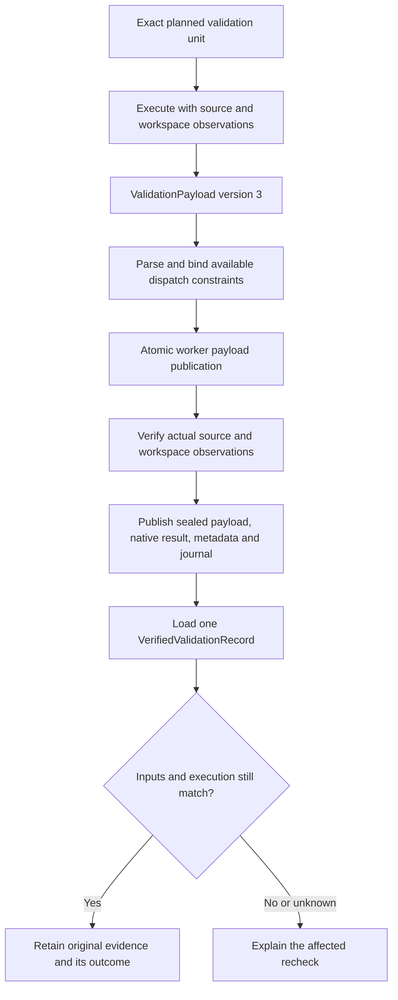

# Review Validation And Check Handoffs

This describes the uncommitted implementation for issue #167 and the decisions
implemented after design review. It does not claim that full repository CI has
passed.

Execute a check once for its inputs, persist the result in one standard format,
and let another agent verify and consume it. Reporting, staging, or a branch
rename should not cause a contracted source-only check to run again.

## Format, Provenance And Applicability

The system distinguishes three questions:

1. **Format:** is the input a correctly formed record with consistent outcomes?
2. **Provenance:** do its dispatch, native result, captured inputs, sealed payload
   and journal identify the recorded execution?
3. **Applicability:** do its inputs and execution contract still match here?

The evidence loader returns an immutable `VerifiedValidationRecord`. Its
`record` contains typed statuses, executions, artifacts, dependencies, source
inputs and the repository contract binding. Core validation policy consumes
those fields. Dictionaries exported with `to_document()` are passive report
and serialization data.

Each incoming handoff crosses the verification boundary once. Journal collection
passes that same loaded result into journal admission instead of loading it
again. Downstream policy does not reconstruct the parsed validation record or
execute commands to read it.

Valid format does not imply a passing check. Failed and blocked results are
valid evidence when they accurately describe the execution. Applicability is
also separate from success: reusing a failed check keeps it failed.

## Publication And Consumption



| Artifact | Purpose | Owner |
| --- | --- | --- |
| Validation unit | Exact commands, directories, environment, features, platform and output policy | Planner/coordinator |
| `ValidationPayload` v3 | Outcomes, timing, evidence, limitations and additional dependency observations | Validator |
| Source captures and workspace snapshots | Observe source/Git state and permitted outputs | Runtime/coordinator |
| Sealed payload | Retain exact worker bytes | Runtime |
| Native result and ledger export | Standard readable result and execution identities | Compiler |
| Evidence metadata | Bind the execution, source inputs, repository contract and payload provenance | Compiler |
| Journal and receipt | Identify admitted evidence without repeating the report | Runtime |

Before writing worker payload bytes, publication checks the schema and typed
payload, exact command order and working directories, concrete executors,
status/exit/timing consistency, dependency ordering, and permitted artifact roots.
Supplied output claims are checked against available runtime observations.
Malformed or contradictory submissions leave the payload and evidence files
unwritten.

The worker payload is staged semantic output. Publication does not count it as
accepted validation. Actual before/after source and workspace observations are
verified before publishing the sealed payload, native artifact, evidence
metadata and journal admission. Compilation checks destination conflicts before
writing; journal publication retains its locking and rollback behavior.

Workers report observations. The runtime owns artifact identities, source
fingerprints, evidence identities and provenance. A failed command produces a
valid failed record; rejection of an invalid submission produces diagnostics.

## One Supported Validation Format

The canonical schema is
[ValidationPayload v3](../agents/.agents/skills/review-graph/references/schemas/validation-payload-v3.schema.json).
Both worker payloads and compiler-derived normalized validation records identify
version 3 explicitly.

```json
{
  "schema_version": 3,
  "status": "passed",
  "executions": [
    {
      "executor": "<actual executor>",
      "command": "<exact dispatched command>",
      "working_directory": "<exact dispatched directory>",
      "result": "passed",
      "exit_code": 0,
      "elapsed": "3.2s",
      "evidence": "<observed execution facts>",
      "artifact_paths": []
    }
  ],
  "limitations": []
}
```

Replace placeholders with dispatched values. Additional observed Git dependencies
use `source-discovery`, `index`, `head` or `history`. They can strengthen the
repository contract. An empty array cannot certify an unknown command or weaken
a declared dependency.

For a failed check, `failure_kind` can be `source`, `infrastructure`, `timeout`
or `inconclusive`. Omission does not establish a reusable source failure.
Executed failures retain concrete exit codes, elapsed time and evidence. Workers
cannot publish a self-declared `reused` result; reuse retains verified original
evidence through an applicability binding. Unneeded checks belong in planning.

Payload schemas v1/v2 and their compatibility tests have been removed. The
current reader rejects unversioned and older validation payloads; it does not
silently migrate them or invent missing provenance. The old handwritten
`local_validation` commit-handoff declaration has also been removed from the
request schema. Superseded bounded-directory v1/v2 and recursive-content v1
output identity modes are also retired. Reuse is derived from verified records and repository contracts.

This change does not rewrite historical evidence or frozen runtime snapshots.
An older record cannot be admitted by the current reader. Obtain current-format
evidence for the affected check when continuing with this implementation.

## Typed API

[review_graph_validation.py](../agents/.agents/skills/review-graph/scripts/review_graph_validation.py)
contains frozen, slotted models for executions, artifacts, dependencies,
payloads, records and verified records. Constructors preserve invariants as well
as parsers, including immutable tuple contents, finite outcome categories,
consistent exit codes and timing, unique output roots and bound identities.

The runtime exposes:

- `load_validation_record(metadata_path=..., artifact_path=...)`: verify one
  persisted handoff and return `VerifiedValidationRecord`.
- `validation_applicability(record, target=..., current_unit=...)`: compare the
  typed record with a verified capture and current execution unit, observing
  required outputs without rerunning commands.

The second API returns rejection reasons; an empty result establishes continued
applicability. It compares command and environment identities separately from
source/Git inputs. The outcome remains available as the typed
`record.record.status`.

The lower-level model supports an injected artifact observer for focused tests
and other callers. The runtime API supplies its existing artifact identity
policy, so callers do not need to implement checksumming themselves.

## Repository-Owned Check Contracts

The repository registry is
[review-validation-contracts.json](../review-validation-contracts.json), with the
[check-contracts v1 schema](../agents/.agents/skills/review-graph/references/schemas/check-contracts-v1.schema.json).
The parser rejects unsupported versions, unknown fields, duplicate IDs or
ambiguous execution selections, unsafe paths and inconsistent input scopes.

Each contract declares:

- exact commands and corresponding repository-relative working directories;
- implementation paths identifying recipes/scripts and configuration;
- `repository` inputs by default, or explicit `prefixes`;
- semantic Git inputs: `index`, `head`, `history` or `comparison`;
- whether source-bound failures are deterministic;
- a rationale for the dependency policy.

A matching contract is bound to the captured Git blob of the registry. Its exact
original bytes are retained in evidence metadata. Readers verify those retained
bytes rather than replace an old contract with a newer working-tree definition.
Implementation paths and the registry are always included in the selected
inputs, even for narrower contracts.

Prefix selection includes the complete captured membership beneath each prefix.
Adding or removing a selected file therefore changes the input set. Narrow
contracts must include all relevant source, configuration, locks, fixtures and
selection dependencies; the runtime does not infer an arbitrary command's
complete dependency graph.

The initial registry contracts cover `just git-config-check`,
`just justfile-fmt-check` and `just ci`. The first two have explicit narrow input
sets, including the justfile's Python configuration dependency. The aggregate CI
contract remains conservative about Git inputs and determinism. Commands without
a matching trusted contract do not gain reusable source-only status from worker
claims.

Environment and external inputs remain separately represented by the execution
unit and its environment identity. The frozen review runtime does not freeze
external validator binaries or hosted services. Contract authors and the planner
must describe those dependencies accurately.

## Source Identity Uses Git Objects

The v4 capture records current repository paths with their Git object format,
file mode and blob ID:

```text
git:sha1:100644:<40-character-blob-id>
git:sha256:100755:<64-character-blob-id>
```

Capture streams regular-file bytes in-process using Git's raw blob framing
(`blob <byte-count>\0`) and the repository's SHA-1 or SHA-256 object format. It
verifies the number of bytes read and rejects observed concurrent file changes.
Clean filters and line-ending normalization are not applied: validators consume
worktree bytes, and distinct bytes must retain distinct identities even when
Git's filtered blobs would match. Capture neither stages files nor writes Git
objects. Modes distinguish executable files, ordinary files and symlinks.
Deleted paths record absence. The runtime also derives a native Git tree ID
without writing that tree.

An unchanged blob alone does not prove that a broad check remains applicable.
Complete repository inputs are the default boundary. Explicit contracts permit
narrower comparisons; input membership and recipe/contract identities are part
of that comparison. Symlink traversal and unavailable native tree identities
receive conservative treatment.

Branch, HEAD, index and comparison context are separate from source content.
Payloads, frozen resources and generated outputs retain their existing integrity
digests; Git object IDs do not replace those non-source bindings.

## Reuse And Git Context Changes

Automatic continuation preserves eligible contracted validation across external
branch/index changes. It also supports an externally performed, authorized
commit or rebase with the same complete source tree and review comparison
boundary: supply
`git_context_authorization` to `resume-after-external-metadata`. This records the
actual user's authorization; the operation does not mutate Git.

The continuation retains original payloads, metadata, artifacts and execution
identities. It records applicability to the new context without relabeling the
original execution as a new run.

| Situation | Decision |
| --- | --- |
| Contracted completed pass; required inputs and execution match | Retain original pass |
| Deterministic contracted `source` failure; required inputs match | Retain failure and keep readiness blocked |
| Infrastructure, timeout, inconclusive or incomplete result | Retain history; use existing bounded recovery/recheck policy |
| Changed selected source, file membership, recipe, contract or output | Recheck affected validation |
| Changed command, directory, environment or output policy | Recheck affected validation |
| Declared Git input changes | Recheck affected validation |
| Changed review comparison base or scope | Require current comparison review |
| Hosted CI attests to another commit | Require exact-commit hosted evidence |
| Different reviewer ID with the same exact planned validation digest | Bind to the existing validation unit |
| Unknown command or missing source/contract evidence | Conservative recheck |

Workers may add Git dependencies and uncertainty; they cannot remove contract
requirements. Source-discovery observations conservatively bind HEAD and index.
History-dependent checks remain conservative about Git context. Other
Git-sensitive checks compare the relevant captured values instead of treating
every metadata change alike.

The separate authorized commit/native-CI handoff still verifies reviewed commit
identity, authorization, retained history and exact hosted targets. Its local
validation bindings now come from the same verified record API instead of
handwritten declarations. Comparison-based reviews keep their comparison proof.

This is not a general cross-run lookup cache. The applicability API supports
narrower input comparisons, including unrelated source edits; source-changing
repair plans still use the existing planning and review routing machinery.
Continued applicability does not waive current routing or review obligations.

## Frozen Runs And Reporting

Bootstrap freezes review runtime code, schemas, routing, skills/references and
the installed support package outside the repository. It pins the Python
executable/version and verifies the resource inventory. Live skill changes apply
to later runs; recovery verifies the saved snapshot.

Routine `report-delivery` consumes persisted evidence and reports
`graph_proof_status: not-certified`. Deferred certification nodes do not force
another collection pass. Failed checks, unfinished semantic reviews and
unresolved routing still block readiness. Explicit certification uses the full
synthesis and `finalize-proof` contract.

Compact worker views and receipts retain complete canonical evidence on disk.
The bounded repair budget remains in effect.

## Implemented Decisions

1. **Use verified typed records for core validation consumers.** One loader
   verifies provenance and dispatch binding; downstream code preserves the type
   and assesses applicability separately.
2. **Check available dispatch constraints before publication.** Invalid submissions
   do not become written validation payloads. Complete observation checks precede
   accepted evidence publication.
3. **Default to complete repository inputs; narrow only by contract.** Include
   selection membership, configuration, locks, fixtures and implementation
   identities rather than assume an unchanged individual blob is sufficient.
4. **Reuse deterministic source-bound failures as negative evidence.** Preserve
   failure and blocked readiness; keep transient/incomplete recovery bounded.
5. **Preserve original evidence across Git context changes and retire old formats.**
   Create applicability bindings without rewriting executions. Reject older
   validation formats; retain exact-commit and comparison obligations.
6. **Make repository-owned dependency contracts authoritative.** Bind them to
   captured registry/implementation objects. Worker observations may strengthen
   them, and unknown commands remain conservative.

## Validation And Measurements

Focused regressions cover typed handoffs, pre-publication rejection, immutable
records, whole-tree/prefix selection, additions/removals, exact contract/dispatch binding, contract/recipe and
execution changes, negative evidence, authorized Git changes, exact hosted CI,
retained history and command formatting. Static checks cover the changed Python
surface. The full suite remains for `just ci`; no complete green CI result is
claimed here.

The previous absent-output regression is retained: successful checks may leave a
permitted output absent, using the canonical absence identity. Executions may
reference only present permitted roots.

[Retained protocol measurements](../agents/.agents/skills/review-graph/references/measurements/frozen-runs-2026-10-12.json)
are historical measurements of the earlier protocol patch: about 38% fewer
worker-facing bytes and 68% fewer instruction bytes in the matched fixture.
Scripted reads/operation counts were unchanged and protocol time was about 5%
slower. Those measurements exclude startup freezing, Git capture and real check
execution; they have not been rerun for this validation-format change.
